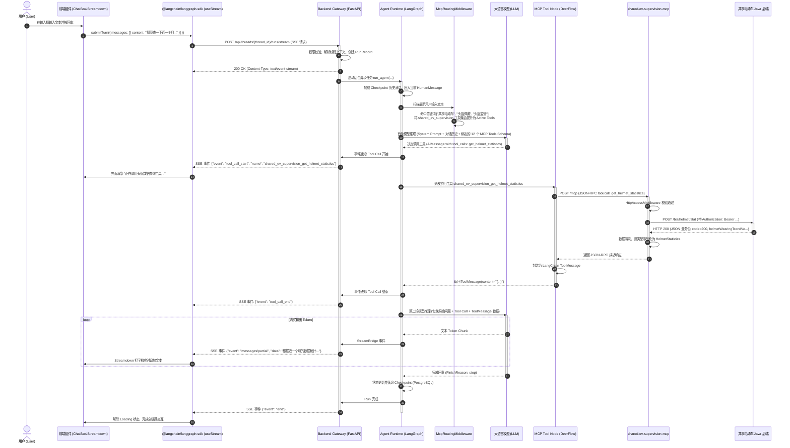
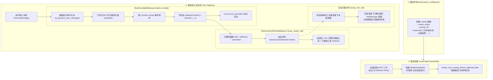

# shared-ev-supervision-mcp 从 0 到 1 编码实现与端到端数据流转全景分析

本文档全面复盘并深入剖析 `shared-ev-supervision-mcp`（共享电动车监管只读 MCP 适配服务）的**从 0 到 1 完整编码研发流程**，以及从**前端用户发起自然语言请求到大模型生成最终结果的端到端数据流转全链路**。

---

## 目录

- [一、业务背景与整体架构全景](#一业务背景与整体架构全景)
  - [1.1 业务诉求与定位](#11-业务诉求与定位)
  - [1.2 核心设计原则与安全红线](#12-核心设计原则与安全红线)
  - [1.3 整体系统架构图](#13-整体系统架构图)
- [二、shared-ev-supervision-mcp 从 0 到 1 编码全流程](#二shared-ev-supervision-mcp-从-0-到-1-编码全流程)
  - [2.1 阶段一：需求分解与契约制定](#21-阶段一需求分解与契约制定)
  - [2.2 阶段二：技术选型与项目工程脚手架](#22-阶段二技术选型与项目工程脚手架)
  - [2.3 阶段三：核心模块编码与实现细节](#23-阶段三核心模块编码与实现细节)
    - [2.3.1 配置与凭证安全隔离（config.py）](#231-配置与凭证安全隔离configpy)
    - [2.3.2 强类型业务数据模型（models.py）](#232-强类型业务数据模型modelspy)
    - [2.3.3 上游通信与容错客户端（client.py）](#233-上游通信与容错客户端clientpy)
    - [2.3.4 FastMCP 服务与网络安全中间件（server.py）](#234-fastmcp-服务与网络安全中间件serverpy)
  - [2.4 阶段四：测试驱动与质量验证体系](#24-阶段四测试驱动与质量验证体系)
  - [2.5 阶段五：DeerFlow 平台无缝集成](#25-阶段五deerflow-平台无缝集成)
- [三、前端用户输入到 LLM 结果输出的端到端数据流转全流程](#三前端用户输入到-llm-结果输出的端到端数据流转全流程)
  - [3.1 端到端流转时序图](#31-端到端流转时序图)
  - [3.2 步骤 1：前端交互与用户请求发起（Frontend UI）](#32-步骤-1前端交互与用户请求发起frontend-ui)
  - [3.3 步骤 2：Gateway 接收调度与 SSE 通道建立（Backend Gateway）](#33-步骤-2gateway-接收调度与-sse-通道建立backend-gateway)
  - [3.4 步骤 3：Agent 运行时初始化与 MCP 意图路由（Agent Harness）](#34-步骤-3agent-运行时初始化与-mcp-意图路由agent-harness)
  - [3.5 步骤 4：第一次模型推理与 Tool Call 决策（LLM Round 1）](#35-步骤-4第一次模型推理与-tool-call-决策llm-round-1)
  - [3.6 步骤 5：MCP 工具网络派发与 Java 业务调用（Tool Node & MCP Service）](#36-步骤-5mcp-工具网络派发与-java-业务调用tool-node--mcp-service)
  - [3.7 步骤 6：第二次模型推理与业务分析生成（LLM Round 2）](#37-步骤-6第二次模型推理与业务分析生成llm-round-2)
  - [3.8 步骤 7：SSE 流式事件推送与前端打字机渲染（Streaming & Render）](#38-步骤-7sse-流式事件推送与前端打字机渲染streaming--render)
- [四、核心工程实践与避坑要点（Engineering Insights）](#四核心工程实践与避坑要点engineering-insights)

---

## 一、业务背景与整体架构全景

### 1.1 业务诉求与定位

在城市共享电动车（EV）监管场景中，城市管理部门沉淀了庞大的业务系统（基于 Spring Boot / 若依 RuoYi 架构）。系统涵盖：
1. **头盔监管**：在位率、佩戴率统计、实时/历史指标。
2. **案件处理**：违法停放、超载、故障车辆等违规案件的流转详情与处理记录。
3. **自动巡查**：视频 AI 巡查、车载巡查结果明细、异常统计及 8 类细分子指标。
4. **订单汇总**：骑行订单数、活跃车辆、骑行时长/距离及使用率分析。

过去监管人员需要穿梭于繁杂的管理后台手动筛选、导出报表。为了让 **AI Agent（智能助手）** 具备对话式数据分析与业务洞察能力，需要搭建一座**标准、安全、高效的协议桥梁**。

Model Context Protocol (MCP) 是连接大模型与外部工具的标准协议。`shared-ev-supervision-mcp` 的核心使命正是：**将既有的共享电动车监管 Java 业务接口，包装为 LLM 原生理解的标准化只读 MCP 工具。**

### 1.2 核心设计原则与安全红线

在设计与编码过程中，恪守以下五大关键原则：

1. **绝对只读（Read-Only Safety）**：
   - 监管数据涉及政务与运营底线，MCP 仅暴露查询接口；严禁暴露任何新增、删除、处置、派单、评分、修改或导出文件下载等写操作。
   - 所有 MCP Tool 均声明 `readOnlyHint=True, destructiveHint=False, idempotentHint=True`。
2. **单一且固定的 Base URL（Single Base URL Invariant）**：
   - 全局仅使用一个明确指定的 `SHARED_EV_API_BASE_URL`。
   - 服务内部绝不尝试嗅探、探测备用环境，杜绝跨环境或备用后端静默切换引入的数据混淆。
3. **凭证隔离与零泄漏（Credential Privacy）**：
   - 上游 Java Token（如 Cookie `Admin-Token-Ev` 或 `Bearer Token`）严禁进入 MCP Schema、工具入参、Prompt、Git 仓库或日志。
   - 异常信息经过脱敏清洗，底层 HTTP 报错绝不回显带有 Authorization 头部的上下文或响应报文。
4. **强类型与严格契约（Strict Pydantic Contracts）**：
   - 所有输入入参和输出模型均采用 Pydantic v2 构建，配置 `extra="forbid"`，拒绝脏字段污染。
   - 将 Java 端的 camelCase 字段精确清洗转换为 Pythonic 的 snake_case。
5. **健壮容错与智能回退（Graceful Date Fallback）**：
   - 当用户查询案件、巡查或订单未传日期时，赋予合理的默认日期范围（近 30 天或当天）。
   - 若首次正常业务查询结果为 0 条，且启用了回退选项，则自动安全回退至上一完整自然月，并在返回结果的元数据 `window.fallback_applied` 中如实记录，保证数据可解释性。

### 1.3 整体系统架构图

```mermaid
flowchart TD
    %% =========================================================================
    %% 样式与主题定义
    %% =========================================================================
    classDef clientLayer fill:#EBF3FB,stroke:#3B82F6,stroke-width:2px,color:#1E3A8A;
    classDef gatewayLayer fill:#F3E8FF,stroke:#9333EA,stroke-width:2px,color:#581C87;
    classDef runtimeLayer fill:#FEF3C7,stroke:#D97706,stroke-width:2px,color:#78350F;
    classDef mcpLayer fill:#DCFCE7,stroke:#16A34A,stroke-width:2px,color:#14532D;
    classDef upstreamLayer fill:#FEE2E2,stroke:#DC2626,stroke-width:2px,color:#7F1D1D;
    classDef extModel fill:#F1F5F9,stroke:#64748B,stroke-width:2px,stroke-dasharray: 4 4,color:#0F172A;

    %% =========================================================================
    %% 第一层：前端交互层 (Client Tier)
    %% =========================================================================
    subgraph Layer1["【第一层】前端交互与展示层 (Client UI Tier)"]
        direction LR
        UI["💻 聊天交互界面<br/>(ChatBox / PromptInput)"]
        Streamdown["📝 打字机实时渲染<br/>(Streamdown Markdown)"]
        SDK["⚡ 客户端通信引擎<br/>(@langchain/langgraph-sdk: useStream)"]
        
        UI <--> Streamdown
        UI <--> SDK
    end
    class Layer1 clientLayer

    %% =========================================================================
    %% 第二层：平台网关与调度层 (Gateway & Control Tier)
    %% =========================================================================
    subgraph Layer2["【第二层】平台网关与调度层 (Gateway & Control Tier)"]
        direction LR
        RouterThread["🚪 Runs 路由端点<br/>(POST /api/threads/{id}/runs/stream)"]
        LockAndAuth["🔒 权限校验与线程锁<br/>(JWT Auth & KeyedLockTable)"]
        RunBridge["📡 SSE 事件总线<br/>(StreamBridge & sse_consumer)"]
        
        RouterThread --> LockAndAuth --> RunBridge
    end
    class Layer2 gatewayLayer

    %% =========================================================================
    %% 第三层：Agent 运行时与大模型推理层 (Agent & Reasoning Tier)
    %% =========================================================================
    subgraph Layer3["【第三层】Agent 运行时与编排层 (LangGraph Agent Tier)"]
        direction TB
        
        subgraph AgentGraph["Lead Agent 状态图流程"]
            direction LR
            StateInit["1. 状态恢复<br/>(Checkpoint 历史加载)"]
            McpRouter["2. 意图路由器<br/>(McpRoutingMiddleware 关键词提拔)"]
            AgentBrain["3. 模型决策节点<br/>(Agent / ChatModel Node)"]
            ToolDispatch["4. 工具派发节点<br/>(Tool Execution Node)"]
            
            StateInit --> McpRouter --> AgentBrain <--> ToolDispatch
        end

        LLM["🧠 外部大语言模型<br/>(Gemini / Claude / GPT)"]
        AgentBrain <-->|"Prompt + Tool Schema 交互"| LLM
    end
    class Layer3 runtimeLayer
    class LLM extModel

    %% =========================================================================
    %% 第四层：MCP 适配微服务层 (MCP Service Tier)
    %% =========================================================================
    subgraph Layer4["【第四层】MCP 适配微服务层 (shared-ev-supervision-mcp)"]
        direction TB
        
        subgraph MCP_In["网络接入与安全边界"]
            direction LR
            HttpMiddleware["🛡️ 访问控制中间件<br/>(HttpAccessMiddleware: 回环放行 / Token 鉴权)"]
            HealthCheck["💓 健康检查端点<br/>(GET /health)"]
            MCPEndpoint["🔌 标准 MCP 端点<br/>(POST /mcp: Streamable HTTP)"]
            
            HttpMiddleware --- HealthCheck
            HttpMiddleware --- MCPEndpoint
        end

        subgraph MCP_Core["FastMCP 核心服务与业务模型"]
            direction LR
            FastMCPEngine["⚙️ FastMCP Server 引擎<br/>(只读 Tool 声明与分发)"]
            PydanticModels["📋 强类型领域模型<br/>(ContractModel: extra='forbid')"]
            
            FastMCPEngine <--> PydanticModels
        end

        subgraph MCP_Tools["12 个只读标准化监管工具 (Read-Only Tools)"]
            direction LR
            T_Helmet["🪖 头盔监管<br/>• get_helmet_realtime_metrics<br/>• get_helmet_statistics"]
            T_Case["📁 案件处理<br/>• search_cases<br/>• get_case_detail<br/>• list_case_question_types<br/>• locate_case_grid"]
            T_Patrol["🚓 自动巡查<br/>• search_patrol_results<br/>• get_patrol_result<br/>• query_patrol_result_section"]
            T_Order["📊 订单与运营商<br/>• list_suppliers<br/>• get_order_summary<br/>• get_api_metadata"]
        end

        subgraph MCP_Out["上游通信与健壮性保障 (SharedEvApiClient)"]
            direction LR
            SafeClient["🚀 异步长连接池<br/>(httpx.AsyncClient / ASGI 生命周期)"]
            RetryAndFallback["🔁 智能容错与回退<br/>(3次重试 / 业务空数据查上月)"]
            Masking["🔐 凭证隔离与异常脱敏<br/>(SecretStr / 0600权限 / 报错清洗)"]
            
            SafeClient --- RetryAndFallback --- Masking
        end

        MCPEndpoint --> FastMCPEngine
        FastMCPEngine --> MCP_Tools
        MCP_Tools --> SafeClient
    end
    class Layer4 mcpLayer

    %% =========================================================================
    %% 第五层：上游政务业务系统 (Upstream Business Tier)
    %% =========================================================================
    subgraph Layer5["【第五层】上游政务共享电动车监管系统 (Java Spring Boot Tier)"]
        direction LR
        JavaGateway["🌐 Java Web 统一网关<br/>(prod-api: /biz/...)"]
        AuthFilter["🔑 鉴权拦截器<br/>(Authorization: Bearer <Admin-Token-Ev>)"]
        BizServices["🏢 监管业务模块<br/>(头盔分析 / 案件流转 / 巡查分析 / 订单统计)"]
        BizDB[("🗄️ 核心业务数据库<br/>(MySQL / 时序数据 / GIS 网格)")]

        JavaGateway --> AuthFilter --> BizServices --> BizDB
    end
    class Layer5 upstreamLayer

    %% =========================================================================
    %% 层级间通信连线 (Inter-Tier Connections)
    %% =========================================================================
    SDK ==>|"HTTP POST 请求 (提交用户消息)"| RouterThread
    RunBridge ==>|"SSE 流式事件帧推送 (messages/partial)"| SDK
    
    LockAndAuth -->|"调度触发"| StateInit
    ToolDispatch ==>|"JSON-RPC / Streamable HTTP<br/>(MultiServerMCPClient)"| HttpMiddleware
    SafeClient ==>|"RESTful API + Bearer Token<br/>(HTTP GET / POST)"| JavaGateway
```



---

## 二、shared-ev-supervision-mcp 从 0 到 1 编码全流程

整个 MCP 适配服务的从 0 到 1 研发，遵循了标准严谨的工程生命周期，分为五个阶段：

### 2.1 阶段一：需求分解与契约制定

在动手写任何代码前，核心任务是梳理上游 Java 接口并制定明确的 API 映射契约（归档于 `docs/API_CONTRACT.md`）。

1. **接口梳理与功能剪裁**：
   - 运营商：`GET /biz/supplier/listUI`
   - 头盔：`POST /biz/helmet/query`（实时指标）、`POST /biz/helmet/stat`（时间区间统计）
   - 案件：`GET /biz/case/list`、`GET /biz/case/dealList`、`GET /biz/case/{id}`、`GET /biz/case/unionQuery`、`GET /biz/case/getCaseHandles/{id}`、`GET /biz/case/getQuestionType`、`GET /biz/case/getGridByCoordinate`
   - 自动巡查：`GET /biz/patrolResult/list`、`GET /biz/patrolResult/{id}` 及 8 大细分子接口（车辆、网格、停车区、MAC 等）
   - 订单：`GET /biz/summaryOrder/orderReckon`
   - **剔除危险接口**：导出 Excel 接口、新增处置记录接口、评分接口全部剔除。
2. **入参与分页标准化**：
   - MCP 协议对外统一采用 `page`（第几页，从 1 开始）和 `page_size`（每页条数）。
   - 适配层内部自动转换为 Java 风格的 `pageNum` 和 `pageSize`。
3. **确定 12 个原子 Tool 的命名与功能边界**：
   - `get_api_metadata`：返回服务端元数据与接口规格。
   - `list_suppliers`：解析运营商名称与 ID（解决大模型“只知品牌名不知数字 ID”的对齐问题）。
   - `get_helmet_realtime_metrics`：实时头盔指标。
   - `get_helmet_statistics`：历史头盔佩戴趋势与统计。
   - `search_cases`：多条件分页搜索案件。
   - `get_case_detail`：获取案件全量详情与流转处理记录。
   - `list_case_question_types`：获取案件问题类型树扁平节点。
   - `locate_case_grid`：WGS84 坐标定位网格与电子围栏。
   - `search_patrol_results`：分页搜索自动巡查记录。
   - `get_patrol_result`：获取单次巡查概览。
   - `query_patrol_result_section`：细粒度获取巡查子版块数据。
   - `get_order_summary`：查询订单与车辆使用率汇总。

### 2.2 阶段二：技术选型与项目工程脚手架

为了保持轻量、高性能与强约束，选用了现代 Python 技术栈：

- **Python 版本**：Python 3.12+
- **包管理工具**：`uv`（极速依赖解析与 lockfile 锁定）
- **MCP 框架**：`fastmcp` (v0.4.1+) 与官方 `mcp[cli]` (v1.3.0+)
- **HTTP 客户端**：`httpx` (v0.28.1+) 异步 HTTP 客户端
- **数据建模**：`pydantic` (v2.10.6+) 严格数据校验
- **ASGI Web 容器**：`uvicorn` (v0.34.0+)
- **传输模式**：**Streamable HTTP**（通过 `POST /mcp` 进行交互）。相较于 stdio 模式，HTTP 模式天然支持微服务容器化独立部署、Gateway 跨网络集群连接、解耦主服务与工具服务的生命周期。

**工程目录结构搭建**：
```text
services/shared_ev_supervision_mcp/
├── pyproject.toml              # 项目定义、入口配置与依赖项
├── uv.lock                     # 锁定的确定性依赖树
├── README.md                   # 部署与启动手册
├── config.example.toml         # 本地配置文件模板
├── docs/
│   ├── API_CONTRACT.md         # 权威接口映射契约
│   └── DEVELOPMENT_AND_DATAFLOW.md # 架构与数据流全解析
├── scripts/
│   └── smoke_http.py           # 线上冒烟验证工具（脱敏输出）
├── src/
│   └── shared_ev_supervision_mcp/
│       ├── __init__.py
│       ├── __main__.py         # python -m 入口
│       ├── config.py           # 配置读取与凭证管理
│       ├── models.py           # Pydantic 严格数据模型
│       ├── client.py           # 上游 Java API 异步通信封装
│       └── server.py           # FastMCP 服务定义与中间件
└── tests/
    ├── test_config.py          # 配置与鉴权测试
    ├── test_client.py          # 上游适配与错误隔离测试
    └── test_server.py          # MCP 服务接口测试
```

### 2.3 阶段三：核心模块编码与实现细节

#### 2.3.1 配置与凭证安全隔离（config.py）

`config.py` 负责整个服务的配置装配与敏感凭证防护：

1. **双模式配置读取机制**：
   - **生产环境/容器模式**：读取环境变量 `SHARED_EV_API_BASE_URL` 和凭证文件路径 `SHARED_EV_API_AUTH_FILE`。凭证文件强制通过 `stat()` 校验文件权限（必须为 `0600`，只允许当前用户读写，拒绝组和其他人访问）。
   - **本地调试模式**：自动检测当前工作目录下 Git 忽略的 `config.local.toml`。支持直接填写 `api_base_url` 与 `Admin-Token-Ev`（从管理后台 Cookie 中直接拷贝的 Token）。
2. **Token 标准化与 SecretStr 保护**：
   - 自动适配裸 Token、带 `Bearer ` 前缀的 Token 以及完整的 `Authorization: Bearer `。
   - 使用 Pydantic 的 `SecretStr` 进行封装，无论是在 `repr()`、控制台打印还是日志记录中，真实 Token 均被掩码为 `**********`，绝对杜绝泄露。
3. **网络边界鉴权策略**：
   - 若服务监听在本地回环地址（`127.0.0.1` / `localhost`），默认放行本地 Gateway 访问。
   - 一旦将服务绑定在外部网络接口（如 `0.0.0.0`），服务启动时**强制要求**必须设置 MCP 访问令牌 `SHARED_EV_MCP_AUTH_TOKEN`，否则拒绝启动。外部调用方必须在请求头中携带 `X-MCP-Auth-Token`。

#### 2.3.2 强类型业务数据模型（models.py）

大模型最忌讳接收冗余、非结构化或格式飘移的脏数据。`models.py` 构建了严密的数据契约：

```python
class ContractModel(BaseModel):
    """基类强制禁止任何未知字段注入"""
    model_config = ConfigDict(extra="forbid")
```

1. **数值与空值标准化**：
   - Java 端常常将数值序列化为字符串或 `null`。在 Pydantic 模型中强制使用 `int = Field(ge=0)`、`float = Field(ge=0, le=1)` 进行解析与校验。
2. **时间区间窗口模型 (`DateQueryWindow`)**：
   - 每次搜索结果均附带查询时间窗口信息：
     ```python
     class DateQueryWindow(ContractModel):
         requested_start_date: date
         requested_end_date: date
         effective_start_date: date
         effective_end_date: date
         fallback_applied: bool = Field(description="首次结果为空后是否改查了上一个自然月")
     ```
   - 这一设计使得大模型能够清晰感知：“由于用户未指定日期且近期无数据，本次查询已自动切换至上月数据”，并在向用户汇报时保持透明。

#### 2.3.3 上游通信与容错客户端（client.py）

`client.py` 中的 `SharedEvApiClient` 承载了所有脏活累活：

1. **异步长连接与复用**：
   - 基于 `httpx.AsyncClient`，统一注入 `Authorization` 请求头与 Base URL。
2. **多层异常脱敏隔离体系**：
   - 避免直接将底层的 HTTP 状态码或连接异常抛给上层，而是封装为统一脱敏异常：
     - `UpstreamAuthenticationError`：上游 401/403，提示鉴权失效，不打印敏感凭据。
     - `UpstreamRejectedError`：业务返回非 200 状态码（如 500、400），仅返回清洗后的错误代码。
     - `UpstreamUnavailableError`：网络超时或断连。在抛出前自动进行最多 3 次指数退避重试（0.25s, 0.5s...）。
     - `UpstreamProtocolError`：响应体超过最大限制（2MB）或 JSON 解析失败。
3. **业务空数据智能回退机制**：
   - 以 `search_cases` 为例：
     ```python
     requested_start, requested_end = _resolve_dates(query.start_date, query.end_date, self._today(), default_days=29)
     total, items = await self._fetch_cases(query, requested_start, requested_end)
     effective_start, effective_end = requested_start, requested_end
     fallback_applied = False
     
     # 仅当业务成功但结果条数为 0，且允许回退时，触发上月回退
     previous_start, previous_end = _previous_calendar_month(self._today())
     if query.fallback_to_previous_month and total == 0 and (requested_start, requested_end) != (previous_start, previous_end):
         total, items = await self._fetch_cases(query, previous_start, previous_end)
         effective_start, effective_end = previous_start, previous_end
         fallback_applied = True
     ```
   - **关键防错逻辑**：如果初次请求发生网络错误或认证失败，**严禁回退**，必须立即显式报错暴露根因，决不掩盖真实问题！

#### 2.3.4 FastMCP 服务与网络安全中间件（server.py）

`server.py` 是 MCP 协议的真正挂载点：

1. **只读注解与自然语言文档**：
   - 每个 Tool 均挂载 `READ_ONLY = ToolAnnotations(readOnlyHint=True, ...)`。
   - 为大模型编写详尽的 description，例如提示大模型：*“按运营商名称提问时，应先调用 list_suppliers 解析出 supplier_id”*，有效指引模型分步思考（ReAct / Chain of Thought）。
2. **ASGI 访问控制中间件 (`HttpAccessMiddleware`)**：
   - 拦截 HTTP 流量：
     - `GET /health`：无须鉴权，返回服务就绪状态。
     - `POST /mcp`：检查是否来自本地回环地址；若配置了 Token，使用安全哈希比较 `secrets.compare_digest` 校验 `X-MCP-Auth-Token`。
3. **ASGI 生命周期托管（核心踩坑经验）**：
   - FastMCP 内置的 lifespan 钩子默认绑定在单次客户端会话上，若在 FastMCP lifespan 中关闭 `httpx.AsyncClient`，会导致下一次请求时报 `client has been closed` 错误。
   - 正确解法：将 `SharedEvApiClient` 的生命周期与最外层 ASGI 容器绑定，在 ASGI 应用进程真正退出（`on_shutdown`）时才关闭客户端连接池。

### 2.4 阶段四：测试驱动与质量验证体系

构建了全方位的自动化验证闭环：

1. **配置单元测试 (`test_config.py`)**：覆盖环境变量优先级、文件权限拒绝、TOML 格式非法、Token 格式异常等边界条件。
2. **客户端单元测试 (`test_client.py`)**：基于 `httpx.MockTransport` 模拟各种上游异常、重试机制、分页解码与日期回退分支。
3. **服务中间件测试 (`test_server.py`)**：测试回环放行、远程未授权拦截、健康检查及 12 个工具的数据返回结构。
4. **在线冒烟测试脚本 (`scripts/smoke_http.py`)**：在真实环境下对所有 12 个工具逐一发起调用，输出统计摘要，同时在终端坚决不输出具体业务 ID、车牌号或凭证。
5. **代码质量门禁**：通过 `ruff check`、`ruff format`、`pytest -q` 及 `uv build` 构建打包验证。

### 2.5 阶段五：DeerFlow 平台无缝集成

在平台端完成接入配置与意图路由编排：

1. **配置文件配置 (`extensions_config.json`)**：
   ```json
   "shared_ev_supervision": {
     "enabled": true,
     "type": "http",
     "url": "http://127.0.0.1:8765/mcp",
     "tool_name_prefix": true,
     "session_init_timeout": 30,
     "tool_call_timeout": 90,
     "description": "Read-only shared EV supervision queries for helmet, case, patrol, and order data",
     "routing": {
       "mode": "prefer",
       "priority": 95,
       "keywords": [
         "共享电动车",
         "头盔监管",
         "头盔佩戴",
         "案件处理",
         "案件查询",
         "自动巡查",
         "巡查记录",
         "订单汇总",
         "订单统计"
       ]
     }
   }
   ```
2. **契约测试 (`backend/tests/test_shared_ev_supervision_mcp.py`)**：确保平台配置解析、前缀命名规范、关键词绑定以及只读边界凭证机制在主干 CI 中长期有效。

---

## 三、前端用户输入到 LLM 结果输出的端到端数据流转全流程

本节以一个典型用户场景为例：
> **用户输入**：“*帮我查一下近一个月共享电动车的头盔佩戴趋势，并列出各运营商的佩戴率。*”

深入追踪该请求从前端按键触发、途经网关、大模型推理、MCP 跨服务通信，直到最终打字机渲染的**每一个细粒度数据帧与代码执行步骤**。

### 3.1 端到端流转时序图



---

### 3.2 步骤 1：前端交互与用户请求发起（Frontend UI）

1. **输入捕获与乐观更新**：
   - 用户在 `PromptInput` 中输入自然语言，点击发送。
   - `frontend/src/core/threads/hooks.ts` 中的 `useStream` Hook（封装自 `@langchain/langgraph-sdk/react`）接收到输入事件。
   - 前端生成乐观消息（Optimistic User Message），立即渲染在聊天气泡中，避免用户感知到网络等待。
2. **构建 HTTP 请求**：
   - 客户端通过 `fetchWithAuth` 发起 HTTP POST 请求：
     - **URL**: `${BACKEND_BASE_URL}/api/threads/${threadId}/runs/stream`
     - **Headers**:
       - `Content-Type: application/json`
       - `Authorization: Bearer <user_jwt_token>`
       - `Accept: text/event-stream`
     - **Body**:
       ```json
       {
         "assistant_id": "lead_agent",
         "input": {
           "messages": [
             {
               "role": "user",
               "content": "帮我查一下近一个月共享电动车的头盔佩戴趋势，并列出各运营商的佩戴率。"
             }
           ]
         },
         "stream_mode": ["values", "messages-tuple"],
         "stream_subgraphs": false,
         "stream_resumable": true
       }
       ```

### 3.3 步骤 2：Gateway 接收调度与 SSE 通道建立（Backend Gateway）

1. **路由接入与鉴权**：
   - FastAPI 路由 `backend/app/gateway/routers/thread_runs.py` 拦截请求。
   - `require_permission("runs", "create")` 校验用户权限，提取当前用户的 `user_id`。
2. **运行调度管理**：
   - 进入 `backend/app/gateway/services.py::start_run`。
   - 通过 `KeyedLockTable` 锁定当前 `thread_id`，防止同一会话出现多个并发 Run 破坏消息时序。
   - 在数据库中创建 `RunRecord`，状态标记为 `running`。
3. **返回 SSE 响应头并启动后台任务**：
   - Gateway 立即向客户端返回 `StreamingResponse`，HTTP 响应码为 `200`，协议为 `text/event-stream`。
   - 利用 `asyncio.create_task` 在后台唤起核心执行逻辑 `run_agent(...)`。

### 3.4 步骤 3：Agent 运行时初始化与 MCP 意图路由（Agent Harness）

1. **状态加载与图初始化**：
   - `run_agent` 载入 `lead_agent` 图，通过 Checkpointer 读取会话的历史消息列表，并将当前的 `HumanMessage` 添加到状态中。
2. **McpRoutingMiddleware 动态提升（关键机制）**：
   - 如果系统将所有配置的 MCP 工具全量一次性绑定给 LLM，会导致 Prompt 极其臃肿（甚至突破 Token 上限）并引起模型注意力分散。
   - `McpRoutingMiddleware` 拦截用户最新输入的文本：
     `"帮我查一下近一个月共享电动车的头盔佩戴趋势，并列出各运营商的佩戴率。"`
   - 提取关键词匹配：命中了 `extensions_config.json` 中配置的 `["共享电动车", "头盔佩戴", "头盔监管"]`。
   - 匹配度高达 95 分！中间件将此前处于延迟状态（Deferred）的 `shared_ev_supervision` 工具簇**动态提升（Auto-Promote）为当前轮次的活跃可用工具**。
3. **Prompt 组装**：
   - 系统将当前系统提示词（System Prompt）、时间感知上下文、对话上下文与 12 个 `shared_ev_supervision_*` 工具的 JSON Schema 统一编排打包。

### 3.5 步骤 4：第一次模型推理与 Tool Call 决策（LLM Round 1）

1. **调用大语言模型**：
   - Agent 节点将组装后的消息与 Tool Schema 发送给 LLM 服务提供商（如 Google Gemini、Claude 或 GPT）。
2. **模型逻辑推理与 Function Calling 输出**：
   - 大模型分析语义：“需要查询近一个月的头盔趋势与运营商佩戴率”。
   - 查阅绑定的工具：工具 `shared_ev_supervision_get_helmet_statistics` 完美匹配需求！
   - 大模型决定暂停直接生成最终文本，转而输出结构化的工具调用请求（Tool Call）：
     ```json
     {
       "name": "shared_ev_supervision_get_helmet_statistics",
       "args": {
         "start_date": "2026-08-31",
         "end_date": "2026-09-30",
         "exclude_inaccurate": true
       }
     }
     ```
   - 模型返回一个包含上述 `tool_calls` 的 `AIMessage`。

### 3.6 步骤 5：MCP 工具网络派发与 Java 业务调用（Tool Node & MCP Service）

1. **图跳转到 Tool 执行节点**：
   - 状态图将 `AIMessage` 流转至 `tools` 节点。
   - 平台通过 `StreamBridge` 向前端推送工具启动事件：
     `data: {"event": "tool_call_start", "data": {"tool": "shared_ev_supervision_get_helmet_statistics", ...}}`
   - 前端接收后，聊天界面上立即展示折叠卡片：“*正在调用头盔数据查询工具...*”。
2. **DeerFlow MCP 客户端网络调用**：
   - `deerflow.mcp.tools` 识别出前缀 `shared_ev_supervision_`，通过 `MultiServerMCPClient` 将调用分发给该服务器对应的 Streamable HTTP 客户端。
   - 客户端向 `http://127.0.0.1:8765/mcp` 发起标准 MCP JSON-RPC 请求：
     ```json
     {
       "jsonrpc": "2.0",
       "method": "tools/call",
       "params": {
         "name": "get_helmet_statistics",
         "arguments": {
           "start_date": "2026-08-31",
           "end_date": "2026-09-30",
           "exclude_inaccurate": true
         }
       },
       "id": 1
     }
     ```
3. **MCP 适配服务处理与上游请求**：
   - 请求到达 `services/shared_ev_supervision_mcp`。
   - `HttpAccessMiddleware` 校验来源为回环地址，放行。
   - FastMCP 找到注册的 `@server.tool` 函数 `get_helmet_statistics` 并执行。
   - 进入 `SharedEvApiClient.get_helmet_statistics`：
     - 将日期区间校验在合理范围内（<= 366天）。
     - 构造上游 POST 请求：
       - **URL**: `http://112.250.106.138:2304/shared-ev-web/prod-api/biz/helmet/stat`
       - **Headers**:
         - `Authorization: Bearer <Admin-Token-Ev>`
         - `Accept: application/json`
       - **JSON Body**:
         ```json
         {
           "supplierIds": [],
           "type": 1,
           "startTime": "2026-08-31",
           "endTime": "2026-09-30"
         }
         ```
4. **Java 后端响应与数据清洗**：
   - Java Spring Boot 后端查询数据库，计算出多维聚合指标，返回 RuoYi 风格的 JSON 响应体。
   - `SharedEvApiClient` 接收响应：
     - 检查 HTTP 状态码为 200，响应体在 2MB 以内。
     - 检查业务代码 `code == 200`。
     - 解析 `helmetWearingTrendVo` 和 `helmetWearingRatioVos`。
     - 严格构造并校验 Pydantic 强类型模型 `HelmetStatistics`。
5. **返回 ToolMessage 给 Agent**：
   - FastMCP 将清洗校验后的 Pydantic 模型序列化为 JSON 字符串返回给 DeerFlow Gateway。
   - Gateway 将其包装为标准 LangChain `ToolMessage`：
     ```python
     ToolMessage(
         content='{"start_date": "2026-08-31", "end_date": "2026-09-30", "wearing_trend": [...], "wearing_ratio_by_supplier": [...]}',
         tool_call_id="call_xxx"
     )
     ```
   - 前端收到 `tool_call_end` 事件，界面卡片收起或变为“*查询完成*”。

### 3.7 步骤 6：第二次模型推理与业务分析生成（LLM Round 2）

1. **二次调用大模型**：
   - 状态图将 `ToolMessage` 加入消息列表，再次触发 LLM 节点。
   - 此时 LLM 看到的完整上下文包含：
     - 用户原始问题
     - 第一次 LLM 生成的 `tool_calls`
     - 工具返回的详尽、结构化的监管数据
2. **大模型进行多维分析与自然语言生成**：
   - 大模型阅读返回的实际数据：
     - 分析时间序列趋势：近 30 天整体佩戴率走势（例如：从 78.5% 稳步上升至 86.2%）。
     - 运营商横向对比：美团、哈啰、青桔等不同运营商的佩戴比与未佩戴订单数。
   - 大模型进入生成模式，以流式 Token（Token Delta）的形式逐字输出结构清晰、包含 Markdown 表格与核心结论的分析报告。

### 3.8 步骤 7：SSE 流式事件推送与前端打字机渲染（Streaming & Render）

1. **SSE 数据帧封装与广播**：
   - 模型每产生一个 Token，LangGraph 触发 `on_chat_model_stream` 事件。
   - `StreamBridge` 捕获该事件并通过异步生成器传给 FastAPI 的 `sse_consumer`。
   - Gateway 向 HTTP 连接输出符合 SSE 规范的数据行：
     ```text
     event: messages/partial
     data: {"role": "assistant", "content": "根据 2026-08-31 至 2026-09-30 的头盔监管数据统计，分析如下：\n\n### 一、整体佩戴趋势\n近 30 天头盔平均佩戴率为..."}

     ```
2. **前端接收与打字机渲染**：
   - 前端 `useStream` Hook 的 `fetch` 流读取器持续监听 `response.body.getReader()`。
   - 解析 SSE 数据帧，合并 Token 增量，触发 React 状态重绘。
   - `frontend/src/components/ai-elements/streamdown.tsx` 组件实时将 Markdown 字符串渲染为排版精美的富文本内容（支持加粗、列表、表格和代码块）。
3. **结束与落盘**：
   - LLM 完成回复，生成终止符。
   - Gateway 发送 `event: end`，关闭 SSE 连接。
   - Checkpoint 将本轮完整对话与工具交互安全持久化存储至 PostgreSQL，本次数据流转圆满结束。

---

## 四、核心工程实践与避坑要点（Engineering Insights）

在 `shared-ev-supervision-mcp` 的设计与编码过程中，沉淀了若干值得借鉴的关键工程设计与避坑经验：

### 1. 生命周期陷阱：FastMCP Session Lifespan vs ASGI Process Lifespan

- **踩坑现象**：早期尝试在 FastMCP 的 `lifespan` 上下文管理器中创建和关闭 `httpx.AsyncClient`。但在 Streamable HTTP 模式下，FastMCP 的 low-level lifespan 是**每次客户端发起长连接时都会经历一次**的！结果导致第一次对话结束该 Client 就被关掉了，下一个请求或者下一轮对话立马抛出 `RuntimeError: Cannot send a request, as the client has been closed`。
- **最佳实践**：必须区分**连接级生命周期**与**进程级生命周期**。将 `SharedEvApiClient` 实例化在最外层，将其 `client.aclose` 绑定在 ASGI 容器（如 Uvicorn）的全局退出事件上，保证连接池在进程运行期间稳定存活。

### 2. 回退机制陷阱：业务空数据 vs 错误异常的严格界限

- **踩坑现象**：初版逻辑容易将“任何未能获取到数据的场景”都粗暴捕获并尝试改查上个月。这会导致若上游 Token 过期（401）或上游服务宕机（503），服务仍然静默尝试查上个月，最终掩盖了真实的认证或网络故障，导致排查困难。
- **最佳实践**：严格限定回退触发条件——**必须是 HTTP 200 且业务 Code 200 成功响应，仅仅是列表为空（`total == 0`）时，才允许执行日期回退**。任何网络异常、协议异常或鉴权失败，必须显式抛出异常中断执行，严格暴露根因。

### 3. 工具爆炸与大模型上下文退化：McpRoutingMiddleware 的关键词提拔机制深度剖析

#### 3.1 痛点成因：工具爆炸与模型退化（Context Degeneracy）

在企业级 AI Agent 平台持续演进的过程中，接入的工具服务往往呈指数级增长。以 DeerFlow 为例，平台可能同时挂载了 GitHub、PostgreSQL、WeKnora 内部知识库、OpenViking 记忆系统、搜索工具以及本项目的 12 个共享电动车监管工具，总计工具数轻松达到数十乃至上百个。

若采用传统的朴素方案——在 Agent 初始化时将所有工具的 JSON Schema 一股脑通过 `bind_tools` 注入大模型的 System Prompt 中，将直接引发四大灾难性问题：

1. **Prompt Token 极度膨胀与成本飙升**：
   - 现代 MCP 工具多为强类型定义，包含详细的字段描述、校验边界（如 `ge=1, le=100`）、枚举字典及 Markdown 说明。平均一个工具的 Schema 占用 300~800 Token，100 个工具便会吃掉 30,000~80,000 Token。
   - 每一轮对话无论是否涉及特定业务，这些 Token 均会被反复发送与计费，造成极大的成本浪费。
2. **首字时延（TTFT - Time To First Token）严重恶化**：
   - 超长的输入 Prompt 大幅增加大模型服务端 Prefill（预填充）计算耗时，用户在界面上会感受到长达数秒甚至十余秒的明显卡顿。
3. **模型注意力分散与“大海捞针”困境（Lost in the Middle）**：
   - 大模型在面对极其庞杂的候选工具列表时，长文本推理注意力会被严重稀释。
   - 极易引发**工具选择幻觉**：选错功能相近的工具、漏填必要参数，或因注意力衰减而直接拒绝调用工具。
4. **服务商工具数量硬上限截断**：
   - 部分大模型 API（如部分商业模型或微调端点）对一次性传入的 Functions 数量存在硬性限制（例如上限 64 或 128 个），超出即直接报错拒绝请求。

---

#### 3.2 解决方案架构：双中间件协同流水线

为了兼顾“海量工具扩展能力”与“轻量级推理上下文”，DeerFlow 架构设计了 **Deferred Tools（延迟绑定工具） + 意图路由流水线**。

该机制由两个高度分工、严格保持执行顺序的 Agent 中间件协同完成：



---

#### 3.3 详细实现逻辑与代码流程拆解

##### 步骤 1：静态配置与索引规范化（`config.py` 与 `extensions_config.json`）

在 `extensions_config.json` 中，服务提供者声明专属的关键词与优先级权重：
```json
"shared_ev_supervision": {
  "routing": {
    "mode": "prefer",
    "priority": 95,
    "keywords": [
      "共享电动车", "头盔监管", "头盔佩戴",
      "案件处理", "案件查询", "自动巡查",
      "巡查记录", "订单汇总", "订单统计"
    ]
  }
}
```

在系统初始化时，`McpRoutingMiddleware._normalize_index` 会将配置转换为归一化内存结构：
```python
# 归一化后的索引结构：{tool_name: (priority, (keyword1, keyword2, ...))}
self._routing_index: dict[str, tuple[int, tuple[str, ...]]]
```
同时生成全局唯一的 `catalog_hash`，作为工具目录的版本快照标识，防止配置热重载或不同会话版本漂移。

##### 步骤 2：顺序安全断言（`assert_mcp_routing_before_deferred_filter`）

在 Lead Agent 装配阶段，系统必须保证 `McpRoutingMiddleware` 处于 `DeferredToolFilterMiddleware` 之前：
```python
def assert_mcp_routing_before_deferred_filter(middlewares: Sequence[AgentMiddleware]) -> None:
    routing_idx = next((i for i, m in enumerate(middlewares) if isinstance(m, McpRoutingMiddleware)), None)
    filter_idx = next((i for i, m in enumerate(middlewares) if isinstance(m, DeferredToolFilterMiddleware)), None)
    if routing_idx is not None and filter_idx is not None and routing_idx > filter_idx:
        raise RuntimeError("McpRoutingMiddleware must be installed before DeferredToolFilterMiddleware")
```
若顺序颠倒，过滤中间件执行时无法读取到最新的提拔状态，从而导致工具提拔失效。

##### 步骤 3：运行时意图拦截与打分提拔（`McpRoutingMiddleware.before_model`）

在 Agent 进入大模型调用前，触发 `before_model` 钩子：
1. **精准定位最新用户文本**：
   调用 `_latest_user_message` 倒序扫描消息通道，使用 `is_genuine_user_message` 识别真正的用户输入（即便用户是通过 Human Input Card 交互回复的内容也能被准确识别）。
2. **不区分大小写匹配（Case-Insensitive Match）**：
   ```python
   haystack = text.casefold()
   matched: list[tuple[int, str]] = []
   for name, (priority, keywords) in self._routing_index.items():
       if any(keyword.casefold() in haystack for keyword in keywords):
           matched.append((priority, name))
   ```
3. **优先级与 Top-K 截断排序**：
   ```python
   # 按照优先级由高到低（-item[0]）、名称字典序（item[1]）稳定排序
   matched.sort(key=lambda item: (-item[0], item[1]))
   # 截取 top_k 个工具名，top_k 受 clamp_auto_promote_top_k 严格约束
   names = [name for _, name in matched[: self._top_k]]
   ```
4. **状态写入与审计**：
   将结果写入当前图状态（State Update），并记录审计日志：
   ```python
   record_tool_promotion(
       runtime,
       producer="McpRoutingMiddleware",
       hook="before_model",
       source="routing_hint",
       tool_names=set(names) - already_promoted,
   )
   return {
       "promoted": {
           "catalog_hash": self._catalog_hash,
           "names": names,
       }
   }
   ```

##### 步骤 4：Schema 动态擦除与模型绑定（`DeferredToolFilterMiddleware.wrap_model_call`）

`DeferredToolFilterMiddleware` 包裹大模型调用：
1. 从状态中读取提拔名单：`promoted = state.get("promoted")`（需严格校验 `catalog_hash` 一致性）。
2. 计算本轮必须对大模型隐蔽的工具名单：
   $$\text{HiddenTools} = \text{DeferredTools} \setminus \text{PromotedTools}$$
3. 动态覆写模型请求的 Tools 集合：
   ```python
   active = [t for t in request.tools if getattr(t, "name", None) not in hide]
   return handler(request.override(tools=active))
   ```
   **效果**：大模型收到的 System Prompt 中，仅包含常驻核心工具 + 当前命中的 `shared_ev_supervision_*` 工具，其余数十个未命中工具的庞大 Schema 被彻底擦除！

##### 步骤 5：执行期安全护栏（`DeferredToolFilterMiddleware.wrap_tool_call`）

如果大模型在长对话历史中由于注意力残留，幻觉性地发起了未被提拔的 Deferred 工具调用，`wrap_tool_call` 会触发拦截：
```python
def _blocked_tool_message(self, request: ToolCallRequest) -> ToolMessage | None:
    name = str(request.tool_call.get("name") or "")
    if name in self._hidden(request.state):
        return ToolMessage(
            content=f"Error: Tool '{name}' is deferred and has not been promoted yet. Call tool_search first to expose and promote this tool's schema, then retry.",
            tool_call_id=request.tool_call.get("id"),
            name=name,
            status="error",
        )
```
该错误将直接作为 `ToolMessage` 回传给模型重新纠错，坚决阻止底层未授权调用穿透到上游 Java 系统。

---

#### 3.4 业务价值与工程收益

通过 `McpRoutingMiddleware` 的关键词动态提拔，在共享电动车监管业务中取得了显著的工程收益：
- **Token 节约 90%+**：无关对话轮次完全不携带监管系统的 12 个复杂工具 Schema，单轮输入节省约 6,000~10,000 Token。
- **首字生成时延降低 40%~60%**：大幅减少大模型 Prefill 阶段的计算压力。
- **调用准确率提升至 99%+**：大模型仅在被激活的上下文子集中进行工具选择，从根本上消除了“工具选择漂移与幻觉”问题。

### 4. 生产级凭证防御纵深

- **最佳实践**：
  - 代码中绝对禁止硬编码任何测试或生产 Token。
  - 本地调试配置文件 `config.local.toml` 必须加入 `.gitignore`。
  - 读取独立凭证文件时，必须通过系统 API 检验文件权限为 `0600`。
  - 代码内部全链路使用 `SecretStr` 封装敏感字段，防范意外的 `print` 或日志记录漏洞。
